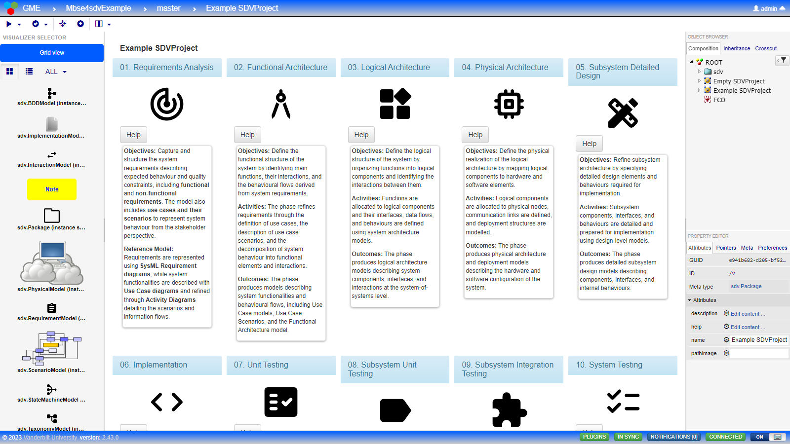
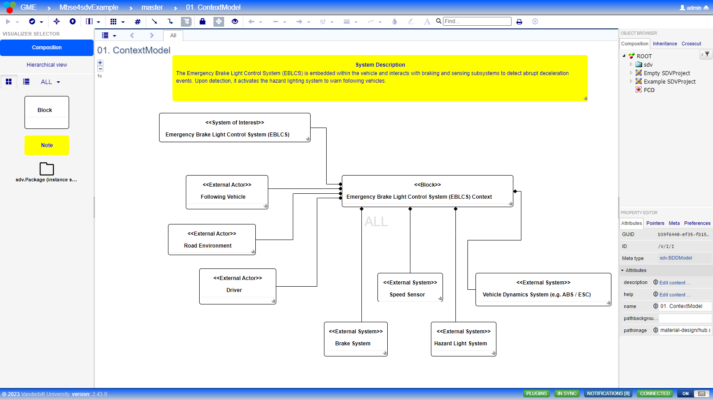
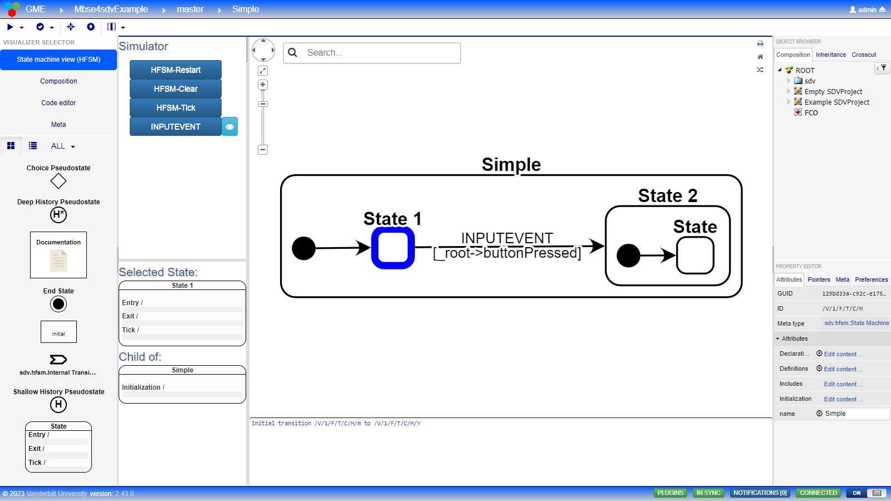
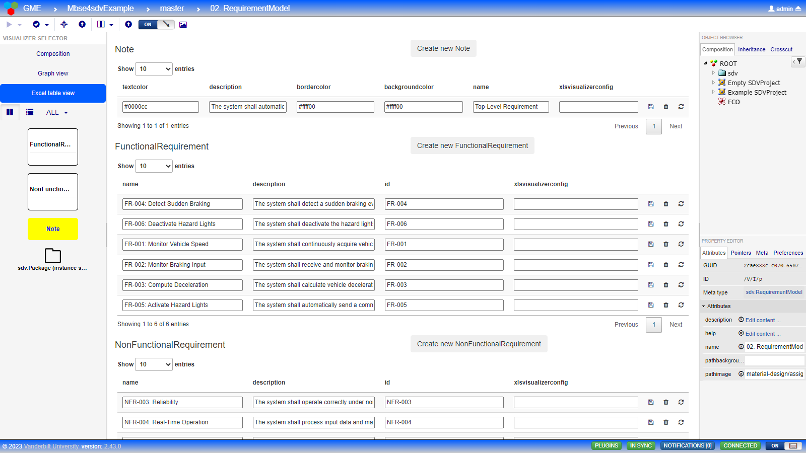
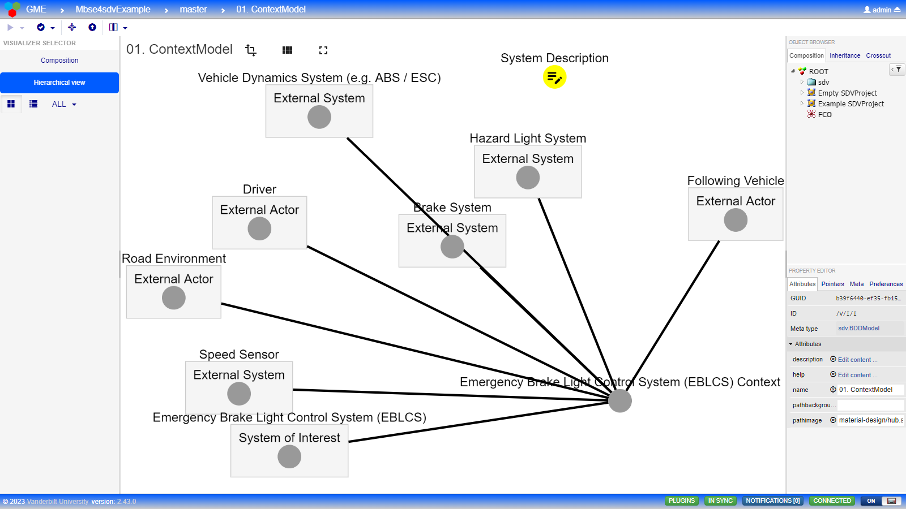

# MBSE4SDV

**Model-Based Systems Engineering for Software-Defined Vehicles** — a collaborative, web-based MBSE workbench
for traceable development of (electric) Software-Defined Vehicles (SDV).

MBSE4SDV operationalises the CODE4EV model-based methodology: lifecycle artefacts (requirements, use cases,
scenarios, functional, logical and physical architecture, detailed design, implementation, testing and
validation) are captured as structured models that several engineers can edit at the same time, version,
trace and transform — instead of disconnected documents. It is built on [WebGME](https://webgme.org), the
open-source web-based modelling environment from Vanderbilt University.



## Features

- **Collaborative modelling in the browser** — multiple concurrent users on shared models, with model-level
  versioning (commits, branches, merge) provided by WebGME.
- **SDV lifecycle metamodels** following an extended V-model: requirements, use cases and scenarios,
  functional / logical / physical architecture, deployment, testing and validation.
- **Hierarchical state machines (HFSM)** with an interactive simulator and C/C++ code generation, provided by
  [webgme-hfsm](https://github.com/finger563/webgme-hfsm).
- **Custom visualisers**: lifecycle grid, table (Excel-like) editing, requirement and traceability matrices,
  scenario and interaction (sequence) diagrams, Kanban, hierarchical graph view, information pages.
- **SysML-inspired decorators** (blocks, ports, notes, UML state machines, interactions).
- **Traceability matrix plugin** across lifecycle artefacts, downloadable as HTML.
- **Example project** of an Emergency Brake Light Control System modelled along the lifecycle phases, with
  vehicle-signal and transportation taxonomies derived from
  [COVESA VSS](https://github.com/COVESA/vehicle_signal_specification) and
  [Smart Data Models – Transportation](https://github.com/smart-data-models/dataModel.Transportation).
- **Programmatic access**: a REST API and an **MCP server** so that LLM-based assistants can query and edit
  models (with the permissions of the logged-in user).

| Composition editor | State machine (HFSM) |
|---|---|
|  |  |
| **Table view** | **Hierarchical view** |
|  |  |

## Quick start (Docker)

Requirements: Docker with Docker Compose.

```bash
git clone https://github.com/ITA-TECNOLOGIA/webgme-mbse4sdv.git
cd webgme-mbse4sdv
cp .env.example .env              # optional: set ADMIN_PASSWORD, ports, ...
docker compose up -d --build
docker compose logs webgme        # shows the generated admin password if ADMIN_PASSWORD was empty
```

| Service | URL |
|---|---|
| MBSE4SDV (WebGME) | http://localhost:8888 — log in as `admin`; open the project **Mbse4sdvExample** |
| MCP server | http://localhost:3000/mcp (Streamable HTTP) |
| REST API | http://localhost:8888/mbse4sdv/api — specification at `/mbse4sdv/api/openapi` |

The MCP and REST URLs are base endpoints for clients, not pages to open in a browser:

- `GET /mbse4sdv/api` returns `{"message":"Not found"}`: the API only exposes `GET /health`, `GET /openapi` and
  `POST` operations (see [REST API and MCP server](#rest-api-and-mcp-server)). To check it is up, open
  http://localhost:8888/mbse4sdv/api/health.
- `GET /mcp` returns `{"error":"Invalid or missing Mcp-Session-Id header"}`: Streamable HTTP sessions start with
  a `POST initialize` from an MCP client. To check the server is up, open http://localhost:3000/health; to try
  the tools, connect a client, e.g. `claude mcp add --transport http mbse4sdv http://localhost:3000/mcp` or the
  [MCP Inspector](https://github.com/modelcontextprotocol/inspector) (`npx @modelcontextprotocol/inspector`,
  transport *Streamable HTTP*).

On first start the container generates the JWT signing keys, creates the administrator account and imports the
example project. Nothing secret is stored in the repository or in the images. To create a new project, use
*Create new project* and choose one of the seeds: **SdvMeta** (SDV lifecycle metamodel, including HFSM),
**HfsmMeta** or **Mbse4sdvExample**.

Data is kept in Docker volumes (`mongo-data`, `webgme-keys`, `webgme-blobs`); `docker compose down -v` removes it.

## Architecture

```
            browser                              LLM client (Claude, ...)
               │                                         │ MCP (Streamable HTTP / stdio)
               ▼                                         ▼
 ┌───────────────────────────────┐   REST    ┌──────────────────────┐
 │ webgme-app  (port 8888)       │◄──────────│ mcp-server (3000)    │
 │  WebGME 2.50 (unmodified npm  │ /mbse4sdv │  tools: login, get_*,│
 │  package + small patch)       │   /api    │  create/modify/      │
 │  + webgme-hfsm 1.8 (npm)      │           │  delete nodes, sets, │
 │  + MBSE4SDV plugins,          │           │  pointers, layout    │
 │    visualisers, decorators,   │           └──────────────────────┘
 │    REST router, seeds         │
 └───────────────┬───────────────┘
                 ▼
            MongoDB (models, users, history)
```

| Folder | Content |
|---|---|
| [`webgme-app/`](webgme-app) | The WebGME application: [plugins](webgme-app/src/plugins), [visualisers](webgme-app/src/visualizers), [decorators](webgme-app/src/decorators), [REST router](webgme-app/src/routers/Mbse4sdvApi), [seeds](webgme-app/src/seeds), Docker image |
| [`mcp-server/`](mcp-server) | MCP server exposing the REST API as tools ([README](mcp-server/README.md)) |
| [`docs/`](docs) | Documentation assets |

MBSE4SDV extends WebGME through its standard extension points (components, routers, seeds, `extraCss`).
The HFSM components (metamodel, `HFSMViz` visualizer and simulator, UML state machine decorators and the
`SoftwareGenerator` code generator plugin) come unmodified from the `webgme-hfsm` npm package and are registered in
[config.webgme.js](webgme-app/config/config.webgme.js); the `HfsmMeta` seed is its metamodel, which `SdvMeta` and
the example include as the `hfsm` library.
The few changes that need the WebGME core are applied with `patch-package` and documented in
[webgme-app/PATCHES.md](webgme-app/PATCHES.md).

## Methodology

The metamodels and the example follow the CODE4EV SDV design methodology: an extended V-model whose phases
(requirements analysis, functional, logical and physical architecture, subsystem detailed design,
implementation, unit / subsystem / integration / system testing, validation, deployment and operational
validation) are represented by the *needs*, *functional*, *system-of-systems*, *hardware/software*,
*subsystem* and *realisation* perspectives, keeping traceability across them. The methodology is described in
the public CODE4EV deliverable **D2.1 – SDV design methodology** (see https://code4ev.eu).

MBSE4SDV is also contributed to the [FEDERATE](https://federate-sdv.eu) SDV ecosystem as the building block
**BB_CODE4EV_MBSE** (functional clusters: Design, Requirements, Generator), published in
[CSA-FEDERATE/Proposed-BuildingBlocks](https://github.com/CSA-FEDERATE/Proposed-BuildingBlocks).

## REST API and MCP server

All model operations are available as JSON endpoints under `/mbse4sdv/api` (e.g. `getMetaDescription`,
`getElementsByMetatype`, `createNodes`, `modifyNodes`, `createPointers`, `setNodesPosition`). Every call except
`POST /login` requires `Authorization: Bearer <token>`; each change is committed to the model history.

```bash
TOKEN=$(curl -s -X POST localhost:8888/mbse4sdv/api/login -H 'Content-Type: application/json' \
  -d '{"username":"admin","password":"<password>"}' | jq -r .token)
curl -s -X POST localhost:8888/mbse4sdv/api/getElementsByMetatype -H "Authorization: Bearer $TOKEN" \
  -H 'Content-Type: application/json' \
  -d '{"project":"admin+Mbse4sdvExample","metaElementType":"FunctionalRequirement"}'
```

The [MCP server](mcp-server/README.md) exposes the same operations as tools for LLM clients; the LLM logs in
with the user's credentials, so it has exactly that user's permissions.

## Development

```bash
cd webgme-app
npm install          # also applies patches/ and rebuilds the WebGME client bundle
export MONGO_URI=mongodb://127.0.0.1:27017/mbse4sdv
npm run users -- useradd -c -s admin admin@example.org <password>
npm start            # http://localhost:8888
```

Node.js 20.19+ (22 LTS recommended) and MongoDB are required. The authentication keys are read from
`webgme-app/token_keys/` (`private_key`, `public_key`; RSA ≥ 2048 bits, never committed) or from
`JWT_PRIVATE_KEY` / `JWT_PUBLIC_KEY`.
Projects created with the pre-release version of the tool can be converted with the
[migration scripts](webgme-app/scripts/migration/README.md).

## Known limitations

- The hierarchical view and the traceability view are slow or show no data when opened on the root package of
  very large models (such as the example, with ~18,000 nodes); open them on a specific model instead.
- Based on WebGME 2.50.1 / webgme-engine 2.32.1. Upgrading to later WebGME releases requires re-applying the
  patch in `webgme-app/patches`.

## License

MBSE4SDV is released under the [MIT License](LICENSE). Third-party components and data included in this
repository keep their own licenses; they are listed, with their license texts, in
[THIRD_PARTY_LICENSES](THIRD_PARTY_LICENSES).
Funding, description and the third-party components required at build or run time are listed in [NOTICE](NOTICE).

## Acknowledgement


&nbsp;&nbsp;
<a href="https://code4ev.eu"></a>

Developed by the [Instituto Tecnológico de Aragón (ITA)](https://www.ita.es) in the project
**CODE4EV – Collaborative Development Framework for Electric Software-Defined Vehicles**
([code4ev.eu](https://code4ev.eu)), which has received funding from the European Union under grant agreement
No 101192739.

Funded by the European Union. Views and opinions expressed are however those of the author(s) only and do not
necessarily reflect those of the European Union or the granting authority. Neither the European Union nor the
granting authority can be held responsible for them.
